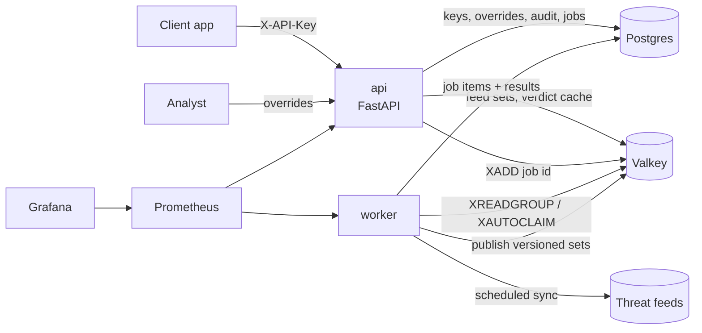

# openverdict

A self-hosted, open-source **threat verdict engine**. Your application sends URLs; openverdict
answers with a verdict for each one and the evidence behind it. Your application decides what to
do with it — block, warn, or let through.

```json
POST /v1/url-checks   {"urls": ["http://malware-drop.test/payload.exe", "https://www.example.com/"]}

{"results": [
  {"url": "http://malware-drop.test/payload.exe",
   "normalized_url": "http://malware-drop.test/payload.exe",
   "verdict": "malicious",
   "reasons": [{"detector": "urlhaus", "verdict": "malicious",
                "detail": "listed in urlhaus: malware_download, 2026-11-20"}],
   "degraded": [], "checked_at": "2026-11-24T10:00:00Z", "error": null},
  {"url": "https://www.example.com/", "normalized_url": "https://www.example.com/",
   "verdict": "safe",
   "reasons": [{"detector": "allowlist", "verdict": "safe", "detail": "top-sites list: example.com"}],
   "degraded": [], "checked_at": "2026-11-24T10:00:00Z", "error": null}]}
```

Verdicts are `safe`, `suspicious`, `malicious` or `unknown`. `unknown` is an honest answer: no
source has evidence either way. `safe` always needs positive evidence.

Part 1 (this release) covers URLs and the platform every detector plugs into. Malware files and
identity attacks are planned as later parts.

## Quickstart: offline demo

Needs Docker with Compose v2. The demo serves synthetic feeds from a local container, so it works
offline and gives the same answers every time (all demo names are reserved `.test` / `example.*`
names — no real threat data).

```bash
docker compose --env-file deploy/compose/demo.env up -d --build
curl -s 127.0.0.1:8000/readyz        # {"postgres":"ok","valkey":"ok"}

export CLIENT_KEY=$(docker compose exec -T api openverdict create-key --name demo-client --role client)
export ANALYST_KEY=$(docker compose exec -T api openverdict create-key --name demo-analyst --role analyst)
demo/requests.sh
```

`demo/requests.sh` checks eight URLs (one per verdict and reason type), shows the 100-URL limit,
creates and removes an analyst override, and runs a 5,000-URL job. Grafana is at
<http://127.0.0.1:3000> (dashboard "openverdict"), Prometheus at <http://127.0.0.1:9090>.

To see crash recovery: start a job, run `docker compose kill worker`, then
`docker compose --env-file deploy/compose/demo.env up -d worker`. The job finishes about 30 s later
(the demo env shortens the reclaim time from the 300 s default).

Stop everything with `docker compose --env-file deploy/compose/demo.env down` (add `-v` to drop data).

## Running with real feeds

```bash
cp .env.example .env          # .env is git-ignored
# set OPENVERDICT_URLHAUS_AUTH_KEY (free key from https://auth.abuse.ch/)
docker compose up -d --build
```

| Feed | What it gives | Notes |
|---|---|---|
| [URLhaus](https://urlhaus.abuse.ch/) recent export (30 days) | malware URLs | free abuse.ch Auth-Key required; synced every 15 min. Without a key the sync is off. |
| [Phishing.Database](https://github.com/Phishing-Database/Phishing.Database) active links + domains | phishing URLs and domains | MIT; ~80 MB download, synced every 6 h. Community-maintained and partly stale: expect some false positives. |
| [Tranco](https://tranco-list.eu/) top list | top-10,000 domains allowlist | synced daily |
| [Google Safe Browsing](https://developers.google.com/safe-browsing) | malware/phishing lookups | **off by default**. Sends checked URLs to Google, and its terms allow **non-commercial use only**. Enable with `OPENVERDICT_SAFE_BROWSING_ENABLED=true` and a key. |

Every feed URL can be overridden (`OPENVERDICT_URLHAUS_URL`, `OPENVERDICT_PHISHING_DB_LINKS_URL`,
`OPENVERDICT_PHISHING_DB_DOMAINS_URL`, `OPENVERDICT_TRANCO_URL`), e.g. to point at a mirror. No
feed data or keys are shipped with this repository: each install brings its own.

## API

Authenticate with the `X-API-Key` header. Keys have a role — `client` (applications) or `analyst`
(people) — and are created from the CLI only:

```bash
openverdict create-key --name billing-app --role client   # prints the key once
openverdict revoke-key --name billing-app
```

| Method and path | Role | What it does |
|---|---|---|
| `POST /v1/url-checks` | client, analyst | 1–100 URLs, answered in the response |
| `POST /v1/jobs` | client, analyst | 1–10,000 URLs → `202` with `job_id` and `Location` |
| `GET /v1/jobs/{id}?offset=0&limit=100` | job owner, analyst | status, progress, results once `done` (limit ≤ 1,000) |
| `POST /v1/overrides` | analyst | `{"target_type": "url"\|"domain", "target", "verdict": "safe"\|"malicious", "note"}` |
| `GET /v1/overrides` | analyst | active overrides |
| `DELETE /v1/overrides/{id}` | analyst | remove an override |
| `GET /v1/audit-log?limit=100&offset=0` | analyst | who changed which override, before and after |
| `GET /healthz`, `/readyz`, `/metrics` | none | liveness, readiness (Postgres + Valkey), Prometheus |

Invalid items do not fail a batch: they come back with `"verdict": null` and `error` set to
`invalid_url`, `unsupported_scheme` (only `http`/`https`) or `too_long` (> 2,048 chars). A URL
without a scheme is `invalid_url`. `degraded` lists detectors that timed out or failed for that
answer. Request bodies over 25 MiB get `413`. Interactive docs: <http://127.0.0.1:8000/docs>.

## Architecture



- **One image, two processes.** `api` answers requests; `worker` runs jobs, syncs feeds and does
  maintenance. Both use the same pipeline code.
- **MVC layout.** `controllers/` are the FastAPI routers, `views/` the Pydantic request/response
  schemas, and `models/`, `services/` and `detectors/` the model layer.
- **Postgres is the source of truth for jobs; Valkey only dispatches them.** A job and its URLs are
  written in one transaction, then its ID goes on a Redis stream. Workers acknowledge a message only
  after the job is finished, so delivery is at-least-once; processing is idempotent (only items
  without a result are written), so a duplicate delivery is harmless. A crashed worker's message is
  reclaimed with `XAUTOCLAIM`, and a sweeper re-enqueues jobs with no progress (covers a failed
  `XADD` or lost Valkey data). Jobs are deleted after 7 days.
- **Feeds are versioned.** A sync writes a complete new version, switches one pointer atomically,
  then deletes the old version. A failed or empty download keeps the old data. A lock ensures only
  one worker replica syncs a feed.
- **Cache without deletes.** Cache keys include a version made from the active feed versions and
  an overrides counter, so a feed refresh or an override change invalidates old answers at once.
  Answers from degraded checks are not cached.

## Detection

For each URL: normalize (scheme and host lowercased, IDNA to punycode, default port, trailing dot
and fragment removed) → analyst overrides → cache → all detectors in parallel (2 s timeout each)
→ combine.

| Detector | Can say | Rule |
|---|---|---|
| `override` | safe, malicious | exact URL beats domain; a domain covers its subdomains; the most specific domain wins |
| `urlhaus`, `phishing_db` | malicious, suspicious | exact URL listed → malicious. Only the host listed → suspicious, never malicious (feeds often list one URL on a shared or hacked host). Host-only matches on allowlisted or user-content hosts (Google Docs, GitHub Pages, S3, …) are ignored. |
| `allowlist` | safe | host or a parent domain in the Tranco top list, unless it is a user-content host |
| `heuristics` | suspicious | URL text only: IP-literal host, mixed scripts, punycode, `user@host` tricks, brand lookalikes in the registered name (edit distance 1, or 2 for brands longer than 6 letters), brand + extra words, deep subdomains, very long URLs, risky TLDs. Weighted; suspicious at score ≥ 3. |
| `safe_browsing` | malicious | opt-in, see above |

Combine rule: any `malicious` → malicious; else any `suspicious` → suspicious; else any `safe` →
safe; else `unknown`.

## Security model

- **The engine never visits submitted URLs** — no fetching, no redirects, no DNS lookups. That rules
  out server-side request forgery and keeps malware off the host. Outbound traffic goes only to the
  configured feed URLs and, if enabled, Safe Browsing.
- **Submitted URLs never leave the system by default**, and are never logged: logs carry the host
  and a SHA-256 of the URL only. Feed download URLs are never logged either (the URLhaus one
  contains the Auth-Key).
- **API keys** are 32 random bytes with an `ov_` prefix, stored only as SHA-256 hashes, shown once.
- **Containers** run as a non-root user with a read-only root filesystem, all Linux capabilities
  dropped and `no-new-privileges`. Compose binds every port to `127.0.0.1`.

## Metrics

Prometheus metrics (prefix `openverdict_`) cover request latency by route, verdicts by type, cache
hit ratio, detector latency and failures, feed freshness and size, job queue depth and duration,
and analyst override outcomes.

The override outcomes double as a **detection-quality signal**. When an analyst creates an override,
the engine records what it would have said without it:

- engine malicious or suspicious, analyst safe → false positive
- engine safe, analyst malicious → false negative
- engine unknown → coverage gap (no evidence, not an error)

The Grafana dashboard shows false positives and false negatives side by side and coverage gaps
separately.

## On AWS

openverdict runs anywhere Docker runs. On AWS, each part maps to a managed service:

| Component | AWS option | Trade-off |
|---|---|---|
| `api` | ECS on Fargate behind an ALB | steady low latency, no cold starts. Lambda + API Gateway is cheaper for spiky traffic but adds cold starts and a 29 s request limit. |
| `worker` | ECS on Fargate, scaled on `openverdict_job_queue_depth` | long-running consumer; a large feed sync is a poor fit for Lambda's 15 min cap |
| Valkey | ElastiCache for Valkey (Serverless or node-based) | Serverless scales without sizing; node-based is cheaper at steady load |
| Job stream | keep Valkey Streams, or swap to SQS | SQS removes operations and its visibility timeout plays the role of `XAUTOCLAIM`; Streams keep one fewer service and allow replay |
| Postgres | RDS for PostgreSQL or Aurora, Multi-AZ | Aurora fails over faster; RDS is cheaper |
| Metrics | Amazon Managed Service for Prometheus + Managed Grafana, or CloudWatch | managed Prometheus keeps the same dashboard and queries |
| Secrets | Secrets Manager (feed keys, database password) | rotation built in |
| Network | private subnets; NAT egress allowlist limited to the feed hosts | defence in depth: even a bug cannot reach arbitrary URLs |
| Infrastructure | Terraform | the whole environment reviewed in Git |

## Development

```bash
uv sync
uv run pytest                 # unit + integration (integration needs Docker: testcontainers)
uv run pytest tests/unit      # no Docker needed
uv run ruff check . && uv run ruff format --check . && uv run mypy src
```

Configuration comes only from `OPENVERDICT_*` environment variables (see
`src/openverdict/config.py` and `.env.example`). The design is in
[`docs/superpowers/specs/`](docs/superpowers/specs/).

## Licence

[Apache-2.0](LICENSE)
